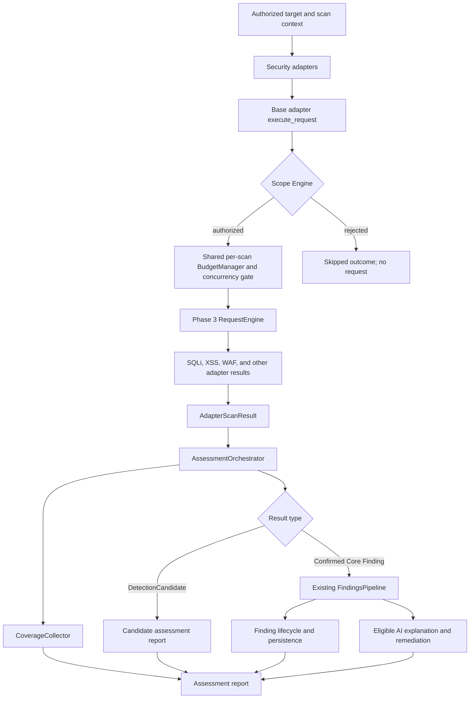

<div align="center">

# AI Look

### An AI-Augmented, Lifecycle-Wide Web Application Security Assessment Platform


[](https://github.com/hamzawy-s/ai-look/stargazers)

AI Look combines deterministic security checks with structured evidence, finding lifecycle management, coverage tracking, reporting, and AI-assisted explanation. Security evidence remains authoritative: AI can help explain findings and remediation, but does not independently confirm vulnerabilities or change technical findings.

[Architecture](#architecture) · [Workflow](#assessment-workflow) · [Capabilities](#implemented-capabilities) · [Setup](#installation) · [Testing](#testing) · [Limitations](#current-limitations)

</div>

---

## Overview

Security assessment tools often blur the distinction between a suspicious response and a verified vulnerability. AI Look keeps those stages separate. Authorized adapters execute bounded checks, retain request and response evidence, and report unverified observations as candidates. Only confirmed Core Findings enter the finding lifecycle and its AI analysis path.

The repository contains a shared Core Engine, scope and HTTP request controls, independent adapter families, assessment orchestration, coverage collection, and report exporters. The current `main.py` initializes the Core Engine; a user-facing scan CLI or service API is not exposed yet.

## Core engineering principles

- **Deterministic evidence:** adapter observations, response data, and lifecycle rules drive security conclusions.
- **AI assistance:** AI supports explanation and remediation for eligible findings; it is not a verification engine.
- **Explicit authorization:** scope checks fail closed before network access.
- **Shared execution controls:** implemented HTTP detectors use one adapter request path, a shared per-scan `BudgetManager`, and the Phase 3 `RequestEngine`.
- **Candidate separation:** candidates remain distinct from confirmed Core Findings, persistence, and confirmed-finding AI tasks.
- **Stable identity and coverage:** fingerprints support lifecycle tracking; coverage preserves present, absent, blocked, error, skipped, and inconclusive outcomes.
- **Evidence hygiene:** sensitive request and response material is redacted before it is retained or reported.

## Architecture



For a multi-adapter scan, create one `BudgetManager` and inject the same instance into each detector. The request engine performs its own scope, DNS, pinning, redirect, response-size, and transport controls.

## Assessment workflow

1. The caller supplies an authorized target, scan identity, scope, and request engine.
2. Scope validation checks each request before the adapter can reserve budget or send it.
3. Adapters execute through `BaseVulnerabilityAdapter.execute_request`, using the scan’s shared budget and concurrency gate.
4. The Phase 3 Request Engine performs controlled HTTP transport and returns structured response metadata.
5. Adapters produce findings only where evidence supports confirmation; otherwise, they return typed candidates or non-present test outcomes.
6. Evidence retains request context, response metadata, and redacted snippets.
7. `AssessmentOrchestrator` records deduplicated coverage through `CoverageCollector`.
8. Only confirmed Core Findings enter `FindingsPipeline`, persistence, lifecycle handling, and eligible AI analysis. Candidates remain separate.
9. `Reporter` exports findings, candidate evidence and verification requirements, and per-test coverage records.

## Implemented capabilities

| Area | Current behavior |
|---|---|
| Core lifecycle | Stable fingerprints, persistence, lifecycle handling, coverage-aware processing, and status-gated AI tasks. |
| Scope and request handling | Strict URL and host checks, explicit scope enforcement, DNS validation and IP pinning, controlled redirects, credential stripping across origins, bounded responses, and transport metadata. |
| SQL Injection | The explicit Phase 5 workflow uses repeated baseline and read-only `AND` TRUE/FALSE controls; it does not call the legacy quote-breakout, `OR`, timing, or UNION probes. Candidates go through a separate repeated verifier, and only a matching **VERIFIED** report can promote one. |
| Cross-Site Scripting | Reflected syntax and static DOM signals can produce **candidates** with inferred context and CSP assessment. Browser execution is not verified. |
| WAF | Harmless baseline, query-marker, and header-marker probes can produce an informational vendor observation. An HTTP status alone is insufficient. |
| Backend fingerprinting | Passive signals from explicit response headers; no active fingerprinting requests. |
| SSRF, LFI, Command Injection | Adapter interfaces are present, but scans report **SKIPPED** pending controlled verification workflows. |
| Orchestration and reporting | Deduplicated coverage, confirmed-finding lifecycle integration, and separate candidate reporting. |

## Project progress

| Phase | Description | Status |
|---|---|---|
| Phase 0 | Core lifecycle corrections | **Accepted** |
| Phase 1 | Adapter contract and coverage | **Accepted** |
| Phase 2 | Scope engine | **Accepted** |
| Phase 3 | Request engine | **Accepted** |
| Phase 4 | Unified execution and orchestration | **Accepted** |
| Phase 5 | Safe SQLi verification and confidence validation | **Reviewed and validated; remote delivery pending** |

Phase 4 validation is recorded in [`docs/phase4-audit.md`](docs/phase4-audit.md). The original Windows Python 3.10.11 Phase 4 run recorded 242 collected and passing tests, 34 focused Phase 4 tests, a passing compile check, and a passing Phase 0–3 plus adapter regression set. The GitHub synchronization also retains and updates a remote-only Core fingerprint regression test; the combined repository suite therefore has one additional test.

Phase 5 design, security boundaries, independent review results, and current validation are recorded in [`docs/phase5-audit.md`](docs/phase5-audit.md). Phase 5 acceptance is pending remote branch verification.

## Repository structure

```text
.
├── adapters/
│   ├── adapter1/                 # SAST and dependency analysis components
│   ├── adapter2/                 # Scope-aware assessment adapters and orchestration
│   │   └── payloads/
│   ├── adapter3/                 # Scheduling and regression components
│   └── shared/                   # Shared browser, JavaScript, and request helpers
├── docs/
│   ├── phase4-audit.md
│   └── phase5-audit.md
├── _legacy/                      # Archived historical regression test
├── mobile/                       # Project placeholder
├── notification/                 # In-process event bus
├── reporting/                    # JSON and CSV report exporters
├── tests/                         # Unit, regression, and controlled integration tests
├── website/                       # Project placeholder
├── config.yaml
├── core_engine.py
├── main.py
├── pytest.ini
├── requirements.txt
└── requirements-dev.txt
```

## Technology stack

- Python 3.10.11 development environment
- `httpx` / `httpcore` for asynchronous HTTP transport
- Pydantic models for structured data
- `aiosqlite` for asynchronous SQLite persistence
- `pytest` and `pytest-asyncio` for tests

See [`requirements.txt`](requirements.txt) and [`requirements-dev.txt`](requirements-dev.txt) for dependency declarations.

## Installation

From the repository root on Windows PowerShell:

```powershell
python -m venv .venv
.venv\Scripts\Activate.ps1
python -m pip install -r requirements-dev.txt
python -m pytest tests/ -v
```

The development requirements pin the tested HTTP, model, database, and test dependencies. The runtime requirements specify minimum versions except for the pinned HTTP client packages.

## Configuration

`config.yaml` contains development defaults for the application name, log level, database path, local AI endpoint and model name, scan concurrency, timeout, and scope-respect setting. AI is disabled by default. The current `main.py` does not yet load this YAML file, so these values are configuration examples rather than a fully wired runtime configuration interface.

No environment variables are required by the current entry point. Do not put credentials or API keys in `config.yaml`; use deployment-specific secret management when an AI service is connected.

## Usage

The current entry point only initializes and closes the Core Engine:

```powershell
python main.py
```

It does not start a scan. Assessment adapters are internal integration components and require a caller to provide authorized scope, a Phase 3 `RequestEngine`, scan identity, and (for multi-adapter runs) one shared `BudgetManager` instance.

## Testing

Run the complete test suite from the repository root:

```powershell
python -m pytest tests/ -v
```

The suite covers Core lifecycle behavior, adapter contracts, scope enforcement, request safety and TLS, budget accounting, detector behavior, reporting, and controlled localhost integration through the real Phase 3 Request Engine. The Phase 5 validation run passed 51 focused Phase 5 tests and 294 total tests on Windows Python 3.10.11; compileall also passed. See the audit reports for baseline and Phase 5 details.

## Security and safety design

- Targets must be explicitly authorized; scope failures are fail-closed.
- Request reservations are atomic and keyed by scan and canonical origin. Invalid origins fail closed.
- Redirects are separately authorized, and cross-origin credentials are stripped.
- DNS results are validated and the selected address is pinned for transport.
- Request and response sizes and timeouts are bounded; incomplete or undecoded responses cannot support negative detection claims.
- Evidence redaction removes sensitive headers, common credential values, and configured secrets.
- WAF probes are harmless. SSRF, LFI, and CMDi do not issue external, internal-service, system-file, or arbitrary-command probes.

## Current limitations

- SQLi verification supports only conservative numeric and bare single-quoted string input grammars and Boolean controls. Other SQL contexts and DBMS products are unsupported; the controlled vulnerable and parameterized integration fixtures use SQLite. The explicit `AssessmentOrchestrator.assess_sqli()` entry point requires timing and UNION probes to be disabled, suppresses redirects per Phase 5 request, and is not automatically invoked by `main.py`.
- XSS remains candidate-only pending browser execution instrumentation. Static syntax, JavaScript parsing, or a DOM sink by itself does not prove exploitability.
- SSRF requires an owned allowlisted callback receiver and bounded interaction wait before controlled verification.
- LFI requires a test-owned temporary sentinel file and verification limited to that fixture.
- Command Injection requires a controlled fixture with a bounded deterministic signal; arbitrary commands are not sent.
- No user-facing scan CLI or service API is exposed. Browser verification and active SSRF, LFI, and command-injection verification remain deferred.

## Roadmap

**Phase 5 — Safe SQL Injection Verification & Confidence Validation** is independently reviewed and locally validated. Its status will be marked accepted after the dedicated branch is pushed and its remote hash is verified. Later phases remain provisional until separately defined.

## Contribution and license

There is no `CONTRIBUTING.md` or `LICENSE` file in the repository. Contributions should preserve authorization, fail-closed behavior, evidence integrity, and candidate-versus-confirmed separation. No license terms are asserted by this README.
